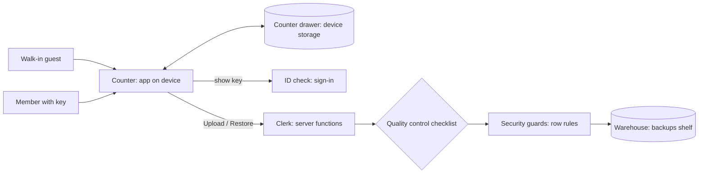

# FinanceFlow: cloud backup architecture (post office edition)

## The big picture

FinanceFlow keeps working the way it does now: your device's counter drawer holds every record, and anyone can use the app as a walk-in guest. A member with a key gets one extra service, a private mailbox in the warehouse. They can drop off up to 10 dated parcels (backups) there and pick any of them up on any device.

There is one delivery truck route: you start it by pressing a button. Nothing syncs in the background.

## 1. Shelves (tables) and their labels

There is one shelf, **backups**, and each parcel on it is one row:

| Label | Meaning |
|---|---|
| id | Parcel tracking number |
| user_id | Owner of the mailbox (the member's ID) |
| created_at | Drop-off time (UTC; shown as YYYY/MM/DD HH:mm) |
| format_version | Version of the parcel format (the same format as the existing JSON export) |
| device_label | Optional label, such as "Laptop" |
| record_count, category_count, purse_count | Counts shown on the parcel label for a quick preview |
| currency | Currency setting at drop-off |
| payload | The full parcel: categories, purses, records and currency, in the same structure as the JSON export |
| size_bytes | Parcel size |

Package tracking: each parcel belongs to exactly one member. There are no links between shelves because the contents travel inside the parcel. The warehouse keeps only the 10 newest parcels per member. When an 11th arrives, a warehouse rule throws away the oldest one automatically.

No profile shelf and no roles shelf. There are no VIP customers or admins yet.

## 2. Security guards (who sees what)
- Walk-in guests cannot reach the shelf at all.
- Members can see, add and delete only parcels in their own mailbox.
- Nobody can change a parcel after drop-off. To replace a backup, you upload a new one.
- Quality control at the warehouse door: the payload must be under 5 MB, the user_id must match the key holder, and the counts must be zero or more.

## 3. ID check (authentication)
- The existing email and password sign-in stays as it is, and new accounts are confirmed automatically.
- No page gets locked. The backup card in Settings shows a sign-in invitation to guests.
- The clerk checks the key again on every upload, list, restore and delete.

## 4. Self-service screens (hooks)
- `useCloudBackups()`: the member's parcel list, newest first, with loading and error states.
- `useUploadBackup()`: packs the counter drawer into a parcel and drops it off.
- `useRestoreBackup(id)`: fetches a parcel, checks it with the existing import checklist, and replaces the counter drawer after you confirm.
- `useDeleteBackup(id)`: removes one parcel.

These live in a new "Cloud backup" card in Settings, next to export and import.

## 5. Back room specialists
None needed. The clerk (server functions) handles everything. The server checks each parcel against the same quality control checklist as file import, so the client is never trusted.

## 6. External vendors
None. No secure back room keys are needed.

## 7. Build order
1. Warehouse shelf, security guards and the keep-10 rule
2. Clerk: list, upload, fetch and delete, each verifying the key, with structured logs
3. Self-service hooks
4. Cloud backup card in Settings: guest invitation, parcel list, upload, restore confirmation, delete confirmation
5. End-to-end check in the preview

## Implementation plan (test-driven, block by block, pausing after each)

**Block 1: Warehouse.** One migration adds the backups table, its permissions, the row rules and the trim trigger. Afterwards I regenerate the database types and run SQL checks: owner-only access, and an 11th insert removes the oldest. How you test it: view it in the backend.

**Block 2: Clerk.** Failing tests first (Vitest with a mocked database client): rejects missing sign-in, rejects bad payloads, upload computes the counts, list returns newest first and caps at 10. Then `src/lib/cloud/backups.functions.ts` using `requireSupabaseAuth`, reusing the validation in `backup.ts`, with entry and exit logs.

**Block 3: Hooks.** Failing tests first for loading, error and success states using TanStack Query, plus restore calling `financeStore.replaceData`. Then the implementation in `src/lib/cloud/useCloudBackups.ts`.

**Block 4: Settings card.** Failing React Testing Library tests first: a guest sees the sign-in invitation and buttons stay disabled; a member sees the list; upload adds a row; restore requires a two-step confirmation; delete requires confirmation; errors show friendly toasts. Then build `CloudBackup.tsx` in the charcoal and amber style, with sentence case and European number formatting.

**Block 5: Verify.** Run the full test suite, then use Playwright signed in to upload, restore on a cleared drawer and delete. Then the guest check.

After each block I explain how to try it in the preview and wait for your go-ahead.

## Technical notes
- Table: `public.backups`. GRANT select, insert and delete to authenticated, and all to service_role, with no anon grant. Enable RLS with `auth.uid() = user_id` policies for select, insert and delete. Leave out the update policy.
- Payload: `jsonb`, capped by a CHECK on `pg_column_size`. Index on (user_id, created_at desc).
- Trim: an AFTER INSERT trigger deletes rows for that user_id beyond the 10 newest.
- Server functions use `context.supabase` (RLS as the user) and never the admin client.
- Record the architecture rule in `AGENTS.md`: device storage is the source of truth, and the cloud holds only manual snapshots.
